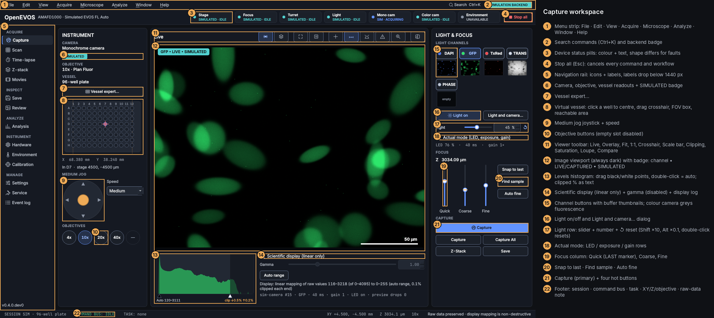

# OpenEVOS UI — build instructions for an implementing AI

**Kit version:** 0.4.0 (reference implementation: OpenEVOS `v0.4.0.dev0`, `src/openevos/ui`)
**Audience:** an AI or a developer building, rebuilding or extending the OpenEVOS desktop UI without
network access.
**What the kit contains:**
- this file and `ACCEPTANCE.md`;
- design tokens (`design-tokens.json`) and Qt stylesheets (`theme-dark.qss`, `theme-light.qss`);
- SVG icons (`icons/`, previewed in `icon-sheet.png`) and fonts (`fonts/`);
- screenshots of every workspace (`screenshots/`) and annotated screenshots (`annotated/`);
- machine-readable specs (`specs/commands.json` lists every menu command; `specs/callouts.json` gives
  widget geometry for the annotated screenshots).

Read sections 0–3 before writing any code. The workspace specs in section 4 are self-contained, and each
one points to its screenshot.

---

## 0. Mission and non-negotiables

OpenEVOS is open-source control and diagnostics software for the **EVOS FL Auto (AMAFD1000)** microscope
and its onstage incubator (AMC1000). The UI must reproduce every control of the original EVOS software,
using the vendor user guide **MAN0007986 Rev C.0** as the behaviour reference. Page numbers ("p.N") in
this file are the guide's printed page numbers. The visual design follows the **Craftimon Studio
design system**.

Hard rules. A build that breaks any of them fails acceptance:

1. **No direct device writes from the UI.** Every state change goes through
   `InstrumentController` → `CommandRouter.submit()` as a typed command. The router validates the command
   (fail-closed safety), reserves the resources it needs, and confirms success by reading the device state
   back. Blocking work runs on worker threads via `SessionModel.submit_when_idle()`; it never runs on the
   GUI thread.
2. **Exposures are scientific acquisitions.** `InstrumentController.acquire()` reserves the camera
   exclusively and holds stage, focus, turret and illumination *shared* for the length of the exposure.
   Nothing moves mid-frame; in particular the filter-cube carriage cannot move during an exposure.
3. **Honesty.**
   - Simulated devices show `SIMULATED`, never "READY".
   - Synthetic frames carry a SIMULATED badge, and saved files say SIMULATED in the TIFF description and
     in the JSON sidecar.
   - Environment readings with no telemetry show `Unavailable`.
   - Nominal vessel geometry and uncalibrated values are labelled as such.
   - Never invent measured values.
4. **Raw data is sacred.** Display transforms (levels, pseudo colour, gamma, overlay brightness/contrast)
   never change raw arrays. In Scientific mode (the default) only linear display mappings are allowed. The
   display log is written into every saved image's sidecar.
5. **Physical gating.** The bring-up record (§5.4) decides what physical hardware may do. Locked subsystems
   (objective turret O, phase wheel P) keep their controls disabled on hardware, with the reason shown.
   Never write firmware or EEPROM. Never bundle vendor binaries.
6. **Colour is never the only signal.** Every state has text; fault states also change shape. Plot series
   also differ by dash pattern.

---

## 1. Architecture

```
openevos-ui (PySide6)                     Qt-free workflow layer                   Phase 2.1 core
┌────────────────────────────┐  calls   ┌─────────────────────────────┐ typed   ┌────────────────────────┐
│ ui/shell.py  MainWindow     │────────▶│ acquisition/controller.py    │───────▶│ core/command_router.py │
│ ui/pages/*   workspaces     │ worker   │ acquisition/capture.py       │ cmds    │  safety (fail-closed)  │
│ ui/widgets/* controls       │ threads  │ acquisition/autofocus.py     │         │  resources/reservations│
│ ui/session_model.py (Qt)    │◀─────────│ acquisition/scan_*.py        │◀─────── │  readback verification │
│ ui/theme.py ui/tokens.py    │ queued   │ acquisition/timelapse.py     │ events  │ core/event_bus.py      │
│ ui/icons.py                 │ signals  │ acquisition/calibration.py   │         │ core/frame_transport.py│
└────────────────────────────┘          │ imaging/{display,composite,  │         └──────────┬─────────────┘
                                        │   save,ome,focus_metrics}.py │                    │
                                        │ analysis/{count,annotations} │      backends/simulation/rig.py
                                        │ instrument/{profile,vessels, │      (stage, focus, turret,
                                        │   settings,readiness}.py     │       LED + cube carriage,
                                        └─────────────────────────────┘       mono + colour cameras)
```

### 1.1 Module map (reference implementation)

| Path | Responsibility | Key API |
|---|---|---|
| `instrument/profile.py` | Cameras (mono/colour), ≤4 cubes + TRANS/PHASE, ≤5 objective slots, provenance | `load_profile()`, `profile.camera(role)`, `channels_for(role)`, `CameraProfile.supports(channel)` |
| `instrument/vessels.py` | Vessel library (12 built-in, Vessel Manager), regions, vessel mm ↔ stage µm | `VesselLibrary`, `Vessel.region_at(x, y)`, `VesselStageMap.to_stage()/to_vessel()` |
| `instrument/settings.py` | All persisted preferences (Mono/Color/Basic/Quick Save/hot buttons/theme) | `AppSettings.load/save`, `ChannelSettings.apply_slider()`, `light_slider_split()` |
| `instrument/readiness.py` | Physical subsystem readiness from the bring-up record | `PHYSICAL_READINESS` |
| `acquisition/controller.py` | The only command entry point; live view; scientific acquisition | `move_stage`, `move_stage_by`, `move_focus`, `set_objective`, `set_light`, `set_exposure`, `set_gain`, `run(ticket)`, `acquire(role, n)`, `start_live/stop_live` |
| `acquisition/capture.py` | Capture, Capture all, Transfection, Z-stack, Snap to last, buffers | `CaptureService.capture(slot, role)`, `ImageBuffers` |
| `acquisition/autofocus.py` | Find sample / Auto fine (Tenengrad sweep + parabolic refinement) | `Autofocus.find_sample()`, `auto_fine()` |
| `acquisition/scan_plan.py` / `scan_runner.py` | Scan routines, 6 coverage modes, tiles, mosaic, output | `plan_scan()`, `ScanRunner.run(plan)` |
| `acquisition/timelapse.py` | Beacons ≤384, scenes, one-frame mode, Z-stacks per time point | `TimelapseRoutine`, `estimate()`, `TimelapseRunner.run()` |
| `acquisition/calibration.py` | Pixel size, parfocality, parcentration, vessel alignment, hot pixels; store | `measure_*`, `calibrate_vessel_alignment`, `find_hot_pixels`, `CalibrationStore` |
| `acquisition/session.py` | Bundles everything; applies calibrations (pixel size, Z/XY compensation on objective change, vessel offset, defect correction) | `build_sim_session()`, `Session.change_objective()`, `pixel_size_um()` |
| `imaging/display.py` | Display mapping, Scientific mode, display log, clipping overlay | `DisplaySettings`, `map_to_8bit`, `clipping_overlay` |
| `imaging/composite.py` | Pseudo colour, overlay, transfection, colour adjust, histogram | `composite(layers)`, `pseudocolor`, `adjust_color` |
| `imaging/save.py`, `imaging/ome.py` | Manual save rules + sidecars; OME-TIFF | `save()`, `validate()`, `SavePreset`, `write_ome_tiff()` |
| `analysis/count.py`, `analysis/annotations.py` | Manual/auto count; Measure annotations, ROI stats, burn-in | `auto_count()`, `ManualCount`, `AnnotationSet`, `roi_stats()`, `burn_in()` |
| `ui/tokens.py`, `ui/theme.py`, `ui/icons.py` | Design system (see §2) | `apply_theme()`, `icon(name)` |
| `ui/session_model.py` | Bus → Qt, frame polling, task runner, log, stop-all, idle-wait | `submit_when_idle()`, `stop_all()` |
| `ui/shell.py` | Menu strip, status bar, rail, footer, command palette, theme/nav | `MainWindow`, `CommandPalette` |
| `ui/pages/*.py` | Workspaces (see §4) | — |
| `ui/widgets/*.py` | `ImageView`, `VesselMap`, `Joystick`, `ChannelButton`, `MarkedSlider`, `LevelsHistogram`, `ParamRow`, `MiniPlot`, `StatusPill`, `Badge` | — |

### 1.2 Threading contract

- **GUI thread:** widgets, `SessionModel`, and the coalescer timers.
- **Workflows:** run on `TaskRunner` threads (one instrument workflow at a time). Results return over a
  queued signal on the runner itself. Do not use a parentless helper `QObject` for this: its queued slot
  calls were lost in practice.
- **UI sliders and buttons:** go through `Coalescer`. It keeps only the latest value per key and sends at
  most one command per device group at a time (exposure and gain share the group `cam-<role>`).
  `submit_when_idle()` waits for the coalescer to drain before starting a workflow, so the workflow's
  commands never collide with slider traffic.
- **Camera settings vs live view:** camera settings need an idle camera. The controller pauses **live
  preview only** (never a scientific acquisition) for an exposure or gain command and resumes it once the
  command finishes.

---

## 2. Design system (Craftimon "Lab")

Source of truth: `design-tokens.json` (generated from `ui/tokens.py`). The contrast table inside it was
measured, and `tests/test_design_system.py` enforces it.

### 2.1 Colour roles

| Role | Dark | Light | Use |
|---|---|---|---|
| `bg` | `#0F1115` | `#FFFFFF` | window |
| `s1` | `#151922` | `#F4F5F7` | chrome, panels, rail, menu strip |
| `s2` | `#1B2029` | `#EAECEF` | buttons, menus, pills |
| `s3` | `#222833` | `#FFFFFF` | inputs, plot backgrounds |
| `tx` / `t2` / `t3` | `#F3F5F7` / `#B4BBC6` / `#8A93A3` | `#14161A` / `#4A5259` / `#5F6877` | primary / secondary / caption text |
| `bd` / `bdd` | `#2A303B` / `#65738E` | `#D8DCE1` / `#7D8794` | hairlines / control borders (≥3:1) |
| `acc` | `#6293FF` | `#3360C8` | main: primary buttons, selection, focus ring |
| `acc_tx` | `#98BAFF` | `#294DA3` | main used as text or links |
| `acc_dim` | `#25314A` | `#DCE6FB` | pressed / checked fill |
| `teal` / `amber` / `violet` | `#52D1D0` / `#EFAB57` / `#E698F7` | `#005F5F` / `#825100` / `#772F87` | accents. Teal also means SIMULATED; amber is the jog knob and callouts |
| `ok` / `warn` / `danger` | `#4CC38A` / `#EFAB57` / `#FF6B6B` | `#1A6E44` / `#8A4B00` / `#B42318` | semantic, **not themeable** |
| `stage` | `#07090C` | `#07090C` | image viewport surround, **dark in both themes** (fluorescence is judged on black) |

Rules:

- **Text on any coloured fill uses `on_color(fill)`.** It is computed for contrast, never assumed. The
  dark main blue takes a *dark* label (`#111111`, 6.4:1); the light main takes white.
- **Theme presets change `acc` only.** Semantic colours never change.
- **Fluorescence pseudo colours** (DAPI `#4F7CFF`, GFP `#2EE66B`, TxRed `#FF4D4D`) come from the
  instrument profile and user settings, never from the UI palette.

### 2.2 Type, spacing, shape

- **Fonts:**
  - **Inter** (bundled OTF) for the UI, with tabular numerals (`QFont.setFeature("tnum")`).
  - **JetBrains Mono** (bundled TTF) for coordinates, frame lines, logs and number boxes.
- **Sizes:**

  | Text | Size and weight |
  |---|---|
  | body | 13 px |
  | labels | 12 px |
  | captions | 11–12 px |
  | panel titles | 15 px semibold |
  | brand | 18 px bold |
  | section headers | 11 px semibold uppercase, +6 % letter spacing (`theme.section_font`; QSS cannot express spacing) |

- **Spacing:** 4 / 6 / 8 / 12 / 16 / 24 px.
- **Radius:** controls 5, buttons 6, panels 8, menus 8.
- **Inspector row:** height 30 px; label column 84 px; grid `[label | control | ↺]`.

### 2.3 Components and conventions

- **Menus.**
  - Two levels at most.
  - **Greyed, not hidden.** A disabled command's tooltip and status tip say *why* ("capture an image
    first", "the colour camera is brightfield/phase only", "no objective in this slot", "the instrument
    is busy with Scan").
  - `…` opens a dialog, `▸` a submenu, a checkmark is a toggle, a dot is an exclusive choice.
  - Shortcuts are right-aligned; destructive items go last; 3–7 items per group.
- **Command palette (`Ctrl+K`, `Alt+Q`).** Lists every command with its menu path and shortcut.
  Unavailable commands are listed greyed, with the reason.
- **Labelled controls.** Tool buttons show an icon plus text. When space runs out, *labels drop first*
  (icon only, with the name in the tooltip and accessible name). Nothing is ever hidden.
- **ParamRow** (every numeric parameter) — see `widgets/param.py`:
  - slider + number box (with units) + `↺` reset;
  - arrows step; Shift ×10; Alt ×0.1;
  - double-click the label to reset; drag the label horizontally to scrub;
  - the label turns semibold and `↺` appears only when the value differs from its default.
- **Status pill.** Title + state text (for example `SIMULATED · IDLE`, `SIM · MOVING`,
  `RECOVERY REQUIRED`, `UNAVAILABLE`). The indicator is a circle for normal states and a square for
  warn/fault/locked. Width 92–140 px; text elides.
- **Badge.** Uppercase 10 px semibold; colour from the state vocabulary; label colour computed.
- **Focus ring.** 2 px `focus` border on inputs and buttons. Every control is keyboard reachable and has
  an accessible name.
- **Icons.** 24 px grid, 1.75 stroke, round caps and joins, `currentColor`. Tint per state
  (normal `t2`, hover `tx`, on `acc_tx`, disabled `t3`) via `icons.icon(name)`. Full set: `icon-sheet.png`.

### 2.4 Window sizes

| Width | Behaviour |
|---|---|
| ≥ 1440 px | rail with icons and labels |
| < 1440 px (automatic mode) | rail shows icons only; group headers and version hidden; profile label hidden below 1500 px |
| Capture viewport column < 1080 px | viewer toolbar switches to icons only |

Side panels flex between minimum and maximum widths (Instrument 248–280, Light & focus 300–330).
Long readouts use `QSizePolicy.Ignored` with a minimum width of 1 so they never force the window wider.
Expect a minimum window width of about 1140 px.
See `annotated/22_capture_narrow_annotated.png`.

### 2.5 Light and dark

`View › Theme` offers Dark, Light and Match system, persisted in `settings.basic.theme`.
`theme.apply_theme()` rebuilds the QSS from tokens, updates module colours and repaints. Pages that cache
icons implement `retint()`. See `screenshots/20_capture_light.png`.

---

## 3. Shell (`ui/shell.py`)



- **Menu strip.** The full tree is in `specs/commands.json`:

  | Menu | Commands |
  |---|---|
  | File | Open image… `Ctrl+O` · Save image… `Ctrl+S` · Quick save `Ctrl+Shift+S` · Export diagnostics… · Settings… `Ctrl+,` · Quit `Ctrl+Q` |
  | Edit | Copy image `Ctrl+C` · Search commands… `Ctrl+K` · Clear all channels |
  | View | Theme ▸ (Dark / Light / Match system) · Navigation ▸ (Automatic / Labels / Icons only) · Zoom to fit `Ctrl+0` · Actual size `Ctrl+1` · ✓ Crosshair · ✓ Scale bar · ✓ Clipping overlay `Ctrl+Shift+C` · ✓ Highlight saturated pixels · ✓ Loupe · ✓ Scientific display · Enter full screen `F11` |
  | Acquire | Live `Ctrl+L` · Capture `Ctrl+Enter` · Capture all · Find sample · Auto fine `Ctrl+F` · Snap to last · Capture focus nominal · Z-stack… · Transfection… · Scan… · Time-lapse… |
  | Microscope | Objective ▸ (slots 1–5, `Alt+1…5`; empty slot greyed) · Channel ▸ (colour-camera-incompatible channels greyed) · Camera ▸ · ✓ Light on `Ctrl+Shift+L` · Vessel… · Light and camera… · Recover device… · Stop all `Esc` |
  | Analyze | Overlay · Measure · Count · Auto count · Count from file… |
  | Window | every workspace, `Ctrl+Alt+1…9` |
  | Help | Getting started… · Keyboard shortcuts… · Search commands… `Alt+Q` · About… |

- **Menu-strip corner.** "Search Ctrl+K" button and the backend badge (`SIMULATION BACKEND`, teal).
  Keep a Python reference to the corner widget: PySide does not take ownership, so a local variable is
  garbage-collected.
- **Status bar.** Brand and profile; seven pills (Stage, Focus, Turret, Light, Mono cam, Color cam,
  Environment); **Stop all** (danger outline). Stop all calls `router.cancel_all()`, stops every
  registered workflow, and sets the autofocus cancel event.
- **Rail.** Groups Acquire (Capture, Scan, Time-lapse, Z-stack, Movies), Inspect (Save, Review),
  Analyze (Analysis), Instrument (Hardware, Environment, Calibration), Manage (Settings, Service,
  Event log). The checked item uses `s3` fill, semibold text and a 2 px `acc` left border.
- **Footer** (mono 12 px):
  `SESSION SIM · <vessel>` | `COMMAND BUS: IDLE / n ACTIVE` (ok/accent) | `TASK: <name>` |
  `XY ±x.xxx, ±y.yyy mm  Z z.z µm  <obj>` | `Raw data preserved · display mapping is non-destructive`.
- **Command enabling.** `_refresh_commands()` runs every 500 ms and before any menu opens. Enabled state
  is never cached.

---

## 4. Workspaces

Each spec lists the controls, what they do, the command or workflow behind them, and when they are
disabled. "Busy" means a workflow owns the instrument: every motion, light and focus control on Capture
is then disabled (operator lock-out).

### 4.1 Capture (manual p.7-9) — `pages/capture.py`

Screenshots: `screenshots/01_capture_live.png`, `02_capture_overlay.png`, `03_capture_clipping.png`;
annotated in `annotated/01_capture_live_annotated.png`.

| # | Control | Behaviour | Command / workflow | Disabled when |
|---|---|---|---|---|
| 1 | Vessel expert… | Category + type dialog with preview; nominal-geometry note | `Session.select_vessel()` | busy |
| 2 | Virtual vessel | Click a well = move to its centre; drag crosshair = move to the drop point. Shows FOV box, current well, dotted reachable envelope | `move_stage` (coalesced key `stage`) | busy |
| 3 | Position readout | `X mm Y mm`, region, stage µm (mono) | store observed position | — |
| 4 | Medium jog | Amber knob; deflection × FOV × speed (0.25/0.6/1.5) every 180 ms; skips while a move is in flight | `move_stage_by` | busy |
| 5 | Objective buttons | Round 42 px; label from profile; tooltip with NA and provenance | `Session.change_objective(slot)`: turret, then parfocal Z + parcentric XY compensation if calibrated | busy · empty slot · physical turret locked |
| 6 | Viewer toolbar | Live, Overlay, Fit, 1:1, Crosshair, Scale bar, Clipping, Saturation, Loupe, Compare (hold, or hold `B`) | view only | — |
| 7 | Viewport | Always dark; wheel zoom, drag pan; badge `CHANNEL • LIVE/CAPTURED • SIMULATED`; scale bar from (calibrated) pixel size; loupe 21×21 px at 8× with value; hover readout `x y (µm) · value` | — | — |
| 8 | Levels histogram | Log histogram of the raw frame, shaded outside the levels; black/white triangle handles; double-click = auto; footer `Auto lo–hi` and `clip ↓% ↑%` (warn colour when > 0.1 %) | display only | — |
| 9 | Scientific display | Default on; gamma row disabled with the reason; display log line under it | `DisplaySettings(scientific=True)` | — |
| 10 | Channel buttons | Up to 4 cubes + TRANS + PHASE; selected = `acc_dim` fill + `acc` border; colour dot with `bdd` outline; buffer thumbnail or "empty" | `set_light(slot, led, power)` + exposure + gain (coalesced) | colour camera + fluorescence (reason in tooltip) · busy |
| 11 | Light on/off | Toggle; a capture always lights the sample, then restores a dark live view | `set_light(enabled)` | busy |
| 12 | Light row | ParamRow 0–100 % → `light_slider_split()` (LED 2→100 %, then exposure to ceiling, then gain to 8×) | as #10 | Actual mode on · busy |
| 13 | Actual mode | Checkbox; reveals LED %, Exposure ms, Gain × rows | as #10 | busy |
| 14 | Focus column | Quick (±150 µm around focus nominal, LAST marker), Coarse (full range, LAST marker), Fine (±25 µm around the position at press, re-centres) | `move_focus` (coalesced `focus`) | busy |
| 15 | Snap to last · Find sample · Auto fine | Last capture Z; 17-point sweep over the vessel range plus refinement; 11 points over 8 DOF × Auto fine range %. Refuses to run with the light off; flat curve → "no sample found" | workflows | busy |
| 16 | Capture | Primary button | `CaptureService.capture()` → shows the captured image | busy |
| 17 | Hot buttons ×4 | Per camera, from settings: Capture, Capture all, Transfection, Save, Z-stack, Capture focus nominal, Quick save | — | NONE · busy |

**Live pipeline.** Preview frames are polled at 15 Hz. Frames with an `acquisition_id` are ignored (they
belong to captures). Auto range is smoothed (0.7/0.3) so the image does not flicker. Pseudo colour is
applied when the channel is fluorescence and "Apply pseudo color" is on.

### 4.2 Light and camera dialog (p.8-9)

- Mono camera (fluorescence + brightfield) or Color camera (brightfield/phase only).
- Apply pseudo color.
- Actual mode with LED / exposure / gain spinboxes.
- Clear all channels (danger).
- Switching camera picks the first compatible channel and restarts live view.

### 4.3 Save (p.10, p.15-17) — `pages/save.py`

Screenshot: `screenshots/10_save.png`.

- **Source:** the overlay of buffered channels, or one channel.
- **Presets:** Default (8-bit colour TIFF + annotations), Quantitative Monochrome (16-bit TIFF raw),
  Custom.
- **Format:** TIFF / PNG / JPEG / BMP.
- **Bit depth:** only the depths the rules allow are listed (16-bit only for TIFF + monochrome).
- **Output:** Colour or Monochrome (Monochrome disabled for colour-camera images).
- **Options:** Include annotations; Save underlying channels (16-bit mono or 8-bit colour).
- **Destination:** folder and base name (`Base_0001.tif`, auto-increment; never overwrite).
- **Rule violations:** shown in warn text, and Save is disabled.
- **Annotations:** when included, the Measure annotations and, if "Save image as screenshot" is on, the
  Count tags and totals are burnt into the colour image.
- **Sidecar** `Base_0001.json`: acquisition metadata, provenance, `display_log`, `burned_in`.
- **Quick save** uses the per-camera Quick Save settings.

### 4.4 Review (p.18) — `pages/workspaces.py: ReviewPage`

- Session buffers.
- Saved-file browser showing each file's sidecar.
- Rename.
- **Delete:** moves the file and its sidecar to `OpenEVOS Trash/` next to it (recoverable, confirmed
  first).
- **Reuse settings:** applies objective, XY, Z, channel, LED, exposure and gain from the metadata, each as
  a validated command.

### 4.5 Analysis (p.11-17) — `pages/analysis.py`

Screenshots: `08_analysis_measure.png`, `09_analysis_autocount.png`, annotated in
`annotated/08_analysis_measure_annotated.png`.

- **Overlay:**
  - per-channel ON/OFF;
  - Brightness and Contrast ParamRows (-100…100) for the picked channel, display only and logged;
  - Reset all channels; Clear channel (danger).
- **Measure:**
  - tools: Text box (click), Arrow, Line, Rectangle, Ellipse, Histogram ROI (drag);
  - at most 12 ROIs, refused with a message beyond that;
  - colour picker;
  - list (name, type, measurement in µm/µm² or px);
  - Show annotations; units µm/pixels; Export all (CSV of `roi_stats` for every underlying channel);
    Delete selected; Delete all;
  - MiniPlot: intensity profile (lines, series dashed alternately) or ROI histogram (bars);
  - per-channel statistics table (mean, SD, min, max, area).
- **Count:**
  - up to 6 labels, each with a colour icon;
  - left-click tags, right-click removes the nearest tag;
  - table of counts, % and Total;
  - Show tags; Show grid (2–10); Save image as screenshot; Delete all tags.
- **Auto count:**
  - Brightness / Area / Circularity ParamRows (toward 100 % = more sensitive);
  - Dark objects on bright background; Separate touching cells (watershed); Aggressive boundaries
    (half-peak tightening);
  - Show cells (outlines in `ok`); Count; Export CSV; results table.
- **Count from file…** opens a TIFF/PNG plus its sidecar as an image (`load_image_file`).

### 4.6 Scan (p.22-27) — `pages/routines.py: ScanPage`

Screenshot: `04_scan.png`, annotated in `annotated/04_scan_annotated.png`.

- **One page, wizard order:**
  1. Name / vessel / objective / camera / channels / save channels separately.
  2. Area: rectangle per well (offset and size) or exactly 2 beacons ("Set beacon 1/2 here").
  3. Find sample (first field) / Auto fine (every field).
  4. Coverage: Full, Four points, Outer region only (%), Center region only (%), Random (N, seeded),
     Grid (rows × cols), plus overlap %.
  5. Save to.
- **Live plan:** selectable vessel map with tile overlay; field count, FOV, estimated time and size;
  warnings (nominal geometry, unverified alignment, tiles outside stage limits — Start disabled while any
  tile is outside).
- **Running:** Start / Pause / Stop (checkpoints between tiles and channels, never mid-exposure),
  progress.
- **Result:** mosaic per channel; Quality High/Medium/Low (1, ½, ¼); Export mosaic… (OME-TIFF all mono
  channels, or PNG of one channel).
- **Stored routines:** JSON in the user data folder; save, recall, delete.

### 4.7 Time-lapse (p.28-32) — `ScanPage`'s sibling `TimelapsePage`

Screenshot: `05_timelapse.png`.

- Objective, camera, channels.
- Auto find sample; Auto fine focus; Z-stack (range, step) at every beacon and time point.
- Auto lighting is shown disabled, with the reason (no validated auto-exposure).
- **Beacons:** up to 384. Add beacon here (stores Z), Populate wells, Update selected, Delete selected,
  Delete all.
- **Scenes:** length, interval, temperature, CO₂ and O₂ setpoints. Setpoints are *recorded only*, with a
  warning.
- Capture one frame only (single scene only).
- Video per beacon, watermark, save channels separately.
- **Estimate:** time points, images, cycle, total. Warns when a cycle exceeds the interval.
- **Running:** Start / Pause / Stop; latest time point grid; late time points counted; focus tracked per
  beacon.
- Export OME-TIFF per beacon (T×C×Y×X).

### 4.8 Z-stack — `ZStackPage`

Screenshot: `06_zstack.png`.

- Channel, below / above / step, slice count.
- Acquire: each slice is a verified Z move, then an exposure; focus returns to its start afterwards.
- Slice slider; maximum-intensity projection; Export OME-TIFF (Z step and pixel size recorded).

### 4.9 Movies (p.33-39) — `MoviesPage`

Screenshot: `07_movies.png`.

- Two viewers. "Apply to" selects Left, Right or Both.
- Source: last Z-stack, or last time-lapse per beacon.
- Start/End, fps, watermark, Play (both viewers in step).
- Export a TIFF stack or an animated GIF.

### 4.10 Hardware — `HardwarePage`

Screenshot: `12_hardware.png`.

- Live device table: id, kind, backend, connection, health, activity, position, capability source,
  recovery.
- Recover device.
- Simulator-only fault injection: fail the next stage move, stall the next focus move, pull the camera
  cable.
- **Physical readiness table** (§5.4).

### 4.11 Environment — `EnvironmentPage`

Screenshot: `13_environment.png`.

- Setpoint vs Measured table; Measured is always "Unavailable".
- Gas ports: 1 = premix/air/custom, 2 = N₂, 3 = CO₂.
- Temperature offset.
- Calibrate oxygen sensor: disabled, with the reason.
- Nothing is ever sent to the AMC1000.

### 4.12 Calibration (p.40-50) — `CalibrationPage`

Screenshot: `15_calibration.png`, annotated in `annotated/15_calibration_annotated.png`.

| Procedure | Method | Applied to |
|---|---|---|
| Objective field of view (pixel size) | image → stage move of 20 % FOV in X and Y → phase correlation; µm/px per slot | scale bars, measurements, metadata `pixel_size_source=calibrated` |
| Parfocality | Auto fine on each objective (lowest magnification = reference), two passes | Z compensation on objective change |
| Parcentration | reference image cropped and rescaled to each objective's scale, then registered | XY compensation on objective change |
| Vessel alignment | brightfield, lowest objective; binary-search the 4 edges of 2 reachable regions (per-axis radii; never past a neighbour or the stage limit) | `VesselStageMap` offset, verified flag |
| FL hot pixel correction | 6 dark frames (light off, 500 ms), median − 5×5 median > 10 × robust MAD; camera settings restored | 3×3-median replacement in captures, recorded in metadata |

- All procedures are disabled on the physical backend until the gates pass.
- Also on this page: Clear all calibrations, Capture focus nominal, Auto fine range ParamRow, vessel
  alignment state.
- The store is `calibration.json` next to the settings file.

### 4.13 Settings — `SettingsPage`

Screenshot: `16_settings.png`. The form is at most 860 px wide.

- **Mono:**
  - four hot buttons;
  - pseudo colour per cube (colour dialog);
  - highlight saturated pixels;
  - block condenser in fluorescence (tooltip: needs the P axis, which is locked; no effect in the
    simulator);
  - underlying channel save;
  - Capture all selection;
  - Quick Save settings.
- **Color:** four hot buttons; brightness / contrast / saturation / hue with Reset; highlight saturated
  pixels; Quick Save.
- **System – Basic:** live gesture; scale bar; Getting started; time-lapse retract objective;
  **Interface** section (Theme, Navigation, Scientific display).
- **Vessel Manager:** save the current vessel under a new ID and name; remove user vessels.

### 4.14 Service — `ServicePage`

Screenshot: `17_service.png`.

- Every Service-tab function from p.43 with a risk class:
  - R0 read-only / R1 configuration — view or available;
  - R2 data / R3 motion — planned or blocked;
  - R4 irreversible (vendor software, firmware, EEPROM) — **blocked**.
- Export diagnostics bundle: events, settings, profile, versions; never images.
- Objective-profile table.

### 4.15 Event log — `EventsPage`

- Time, level, event; filter all / warnings and errors / errors.
- Every rejected or failed command appears here with the router's message.

---

## 5. Behaviour specs

### 5.1 Command lifecycle shown in the UI

```
QUEUED → VALIDATING → ACCEPTED → RUNNING → SUCCEEDED
                  ↘ REJECTED        ↘ FAILED / CANCELLING → CANCELLED / TIMED_OUT (recovery required)
```

- Pills reflect device snapshots.
- Rejections are logged with the reason (for example "resource conflict", "outside […] um",
  "activity is moving").
- A timeout keeps the reservation until **Recover device**.

### 5.2 Capture sequence

`check_capture` (camera ↔ channel, objective present) → `set_light(slot, LED, on)` waits SUCCEEDED
(carriage travel) → `apply_camera(exposure, gain)` (live paused per command) → `acquire(role, 1)`
(reservation, scientific stream; refused if any device is busy) → `CapturedImage` with channel check,
pixel size (calibrated or nominal), XY/Z/LED/gain from the frame metadata, optional hot-pixel correction
→ buffer → restore a dark live view if the power is off.

### 5.3 Objective change with calibration

turret SUCCEEDED → Z += parfocal[new] − parfocal[old] → XY += parcentric[old] − parcentric[new].
Each step is a separate verified command.

### 5.4 Physical readiness (bring-up record, `instrument/readiness.py`)

| Subsystem | Readiness | UI consequence |
|---|---|---|
| X/Y stage | Verified, limited | 22 mm boot box until Gate 7 |
| Z focus | Verified, limited | per-objective safe-Z envelope required |
| F cube carriage | Verified, limited | no exposure while it moves |
| O objective turret | **Locked** | objective buttons disabled on hardware |
| P phase/condenser wheel | **Locked** | phase channel and block condenser disabled on hardware |
| LED board | Verified, limited | light control only in application mode (`0DAD:0051`) |
| Mono / colour cameras | Not integrated | simulator frames only |
| AMC1000 | Unavailable | setpoints only |
| `lico` calibration blob | Verified, limited | read-only "recovered" values |

---

## 6. Simulator (what tests and screenshots run against)

`backends/simulation/rig.py` + `optics.py` render a deterministic synthetic culture that exists only
inside vessel regions. It models:

- magnification-dependent FOV;
- NA-based depth of field and defocus blur;
- parfocal offsets (slot 2 = 3.0, 3 = 5.0, 4 = 7.5 µm);
- parcentric offsets (slot 2 = (4, −3), 3 = (−6, 5), 4 = (7, 4) µm);
- a true vessel placement offset of (180, −120) µm;
- 36 hot pixels on the mono camera, growing with exposure;
- LED × exposure × gain with shot and read noise and 12-bit saturation;
- an 8-bit colour camera;
- darkness while the carriage travels;
- slow cell migration.

The calibration tests assert that every procedure recovers these values.
**These numbers are synthetic and must never be shown as EVOS specifications.**

---

## 7. Data formats

- **Settings:** `ui_settings.json` (pydantic `AppSettings`, `schema_version` 1).
- **Calibration:** `calibration.json` — `pixel_size_um{role:{slot:µm}}`, `parfocal_um`, `parcentric_um`,
  `vessel_offset_um{vessel:[dx, dy]}`, `hot_pixels{role:[[y, x]]}`, `updated{procedure:ISO}`,
  `provenance`.
- **Image sidecar:** `openevos_save`, `primary` (`CapturedImage.metadata()`), `channels`, `provenance`,
  `display_log[]`, `burned_in[]`.
- **Scan output:** `tileNNNN_<region>_<slot>.tif` (description = metadata JSON), `mosaic_<slot>.tif`,
  `manifest.json`.
- **OME-TIFF:** axes `TZCYX`, PhysicalSizeX/Y (µm), PhysicalSizeZ, TimeIncrement, channel names; the
  Description says SIMULATED when the frames are synthetic.
- **Routines:** pydantic JSON (`ScanRoutine`, `TimelapseRoutine`).

---

## 8. Build order for an implementing AI

1. Tokens, QSS, fonts, icons (§2). Check against `design-tokens.json` contrast values; run
   `tests/test_design_system.py`.
2. Widgets: `ParamRow`, `StatusPill`/`Badge`, `ImageView` (zoom, pan, badge, scale bar, loupe, compare,
   hover value, click/drag, shapes), `LevelsHistogram`, `ChannelButton`, `Joystick`, `MarkedSlider`,
   `VesselMap`, `MiniPlot`.
3. `SessionModel` (queued bus dispatch, frame poll, `TaskRunner` with a queued-signal delivery,
   `submit_when_idle`, `stop_all`).
4. Shell: menus from §3 with `why_disabled` lambdas, palette, status pills, rail with narrow behaviour,
   footer.
5. Capture (§4.1), then Save, Analysis, Scan, Time-lapse, Z-stack, Movies, Review, then the Instrument
   and Manage pages.
6. Run `QT_QPA_PLATFORM=offscreen python tools/make_ui_screenshots.py out/`. Compare against
   `screenshots/` and the annotated images. Then run the whole `ACCEPTANCE.md` checklist and
   `python -m pytest`.

## 9. Pitfalls already paid for (do not repeat)

| Pitfall | Fix |
|---|---|
| Qt combo boxes return a `str`-Enum's data as a plain `str` | Convert back: `CameraRole(combo.currentData())` |
| A parentless helper `QObject` used for cross-thread delivery loses its queued calls | Emit a signal on the long-lived `TaskRunner` |
| PySide does not own corner widgets | Keep `self._corner` |
| A camera command killed a running acquisition by "pausing live" | Pause only when `current_acquisition is None` |
| Exposure and gain on one camera, sent concurrently, conflict | Coalescer group `cam-<role>` |
| A long readout label forced the window to 1600 px | `setMinimumWidth(1)` + `QSizePolicy.Ignored` |
| A layout's minimum width ignores later compaction | Flexible panel min/max widths and a 1440 px rail threshold |
| Hot-pixel dark frames left exposure at 500 ms | Restore the camera settings after the procedure |
| Vessel alignment from corner wells left the stage limits | Choose reachable regions; bound edge searches by neighbour distance and stage limits; per-axis radii for slides and flasks |
